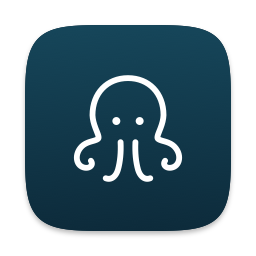

# Loco Loco

An app for the localhost servers you have running, in the macOS menu bar or the Windows taskbar. See them in one place, stop the ones you don't need, and restart them later from Stopped.

## Install on a Mac

You need macOS 14 or later and the Xcode Command Line Tools. If `swift --version` prints nothing, run `xcode-select --install` first.

```sh
git clone https://github.com/Rakshitkeswani1210/loco-loco.git
cd loco-loco/app/macos
./scripts/build.sh
```

The script builds the app, puts it in `~/Applications` and opens it. An octopus shows up in the menu bar, with the number of running servers next to it. When nothing is running, the octopus sleeps.

macOS may ask to let Loco Loco access a folder such as Documents or Desktop. Click Allow, so it can name each server after its project folder.

To update, run `git pull` and the script again.

## Install on Windows

You need Windows 11.

1. Download `LocoLoco-1.0.0-windows-x64.zip` from [Releases](https://github.com/Rakshitkeswani1210/loco-loco/releases/latest). On an Arm PC, take the `arm64` zip.
2. Unzip it anywhere, for example into `Documents`, and run `Loco Loco.exe` in the `Loco Loco` folder.
3. The app isn't signed, so SmartScreen asks the first time. Click More info, then Run anyway.
4. The octopus starts under ^ at the right of the taskbar. Drag it onto the taskbar so it's always in view.

To update, quit Loco Loco and unzip the new version over the old folder.

## Use

- Click the octopus to see Running and Stopped.
- Or press ⌃⌥L in any app to open Loco Loco in the middle of the screen. Press it again, or Esc, to close. To change it or turn it off, open Settings.
- Click a running row to open it in the browser. Hover it to stop it.
- Hover a stopped row to restart it. It runs the same command in the same folder, in the background.
- Right-click a row for Copy URL, Show in Finder (File Explorer on Windows), Open in Terminal, Show log, and Open in Cursor if you have Cursor.
- To forget a stopped server, right-click it and choose Remove from history, or select it with the arrow keys and press ⌘⌫. Clear history… in the ··· menu forgets them all.
- On the Mac, each row shows its project in a coloured label. The project is the first folder in Documents, Desktop or Downloads (or in your home folder), and a git worktree shows the project of its main repo. Right-click a row and choose Rename project… to give it a shorter name.
- On the Mac, hover a row for a card with a snapshot of the page, its title, and the servers it needs. Space shows it from the keyboard. A stopped static site shows its page too, read from its folder.
- On the Mac, Restart starts what a server needs first, one at a time: a frontend's API, then the frontend. Loco Loco finds them in the start command, its script, its .env files and its environment. Right-click › Needs fixes a wrong guess.
- On the Mac, Stopped is grouped by project: a project with two or more stopped servers is one line you click to open. Hover a project's label to stop or restart all of it.
- On the Mac, the Hosted tab lists your Rayfin demos, found from each project's `rayfin` folder under Documents. Click one to open it, hover for Copy, or hover a project's label to copy all its links. Right-click for Copy name and link, which pastes as a hyperlink in Teams and Outlook, Open in Fabric, Rename… and Hide. Add link… in the ··· menu takes any other link.
- On the Mac, type as soon as the panel is open, or click the search button, to find any server or hosted link by name, port, project, folder, command or page title. Return acts on the top result, and Esc goes back.
- On the Mac, the ··· menu has Stop all…, Clear history…, Add link…, Settings… (⌘,) and Quit.
- Settings has Launch at login, the menu bar count, which servers to show, Group by project (puts running servers under a header for each project), Appearance (System, Light or Dark), Transparent background (Liquid Glass), the keyboard shortcut and how long to keep history (7, 30 or 90 days on the Mac).
- On Windows, the ··· menu has Stop all, Start with Windows and the other settings, and right-clicking the octopus gives Open Loco Loco, Stop all… and Quit Loco Loco.

Loco Loco lists processes that listen on a port and run from a folder inside your home folder, so apps like Figma stay hidden. On the Mac, jobs that open a port for a moment stay hidden too: test runs, builds, and anything on a random high port for its first 10 minutes. It can only see and stop your own processes.

## Your data

Everything stays on your computer. For each stopped server, the history keeps the folder, command, port and PATH, and no other environment variables. On the Mac it also keeps the page's title and the ports a server needs (ports only, never the values they came from). The Hosted tab reads only the URL, date and Fabric link from Rayfin's deploy file and the name and ports from `rayfin.yml`. It never reads your Rayfin sign-in or `.env`, and makes no network calls.

- Mac history: `~/Library/Application Support/Loco Loco/history.json`. Restart output: `~/Library/Logs/Loco Loco/`. Hosted links: `links.json` in the same folder as the history. Page snapshots: `~/Library/Caches/Loco Loco/Snapshots/`
- Windows history: `%LOCALAPPDATA%\Loco Loco\history.json`. Restart output: `%LOCALAPPDATA%\Loco Loco\Logs\`

## Uninstall

- Mac: choose Quit Loco Loco from the ··· menu, then delete `~/Applications/Loco Loco.app` and the three folders above.
- Windows: turn off Start with Windows in the ··· menu, choose Quit Loco Loco, then delete the `Loco Loco` folder you unzipped and `%LOCALAPPDATA%\Loco Loco`.

## Develop

- `app/macos/scripts/test.sh` runs the Mac tests.
- `app/windows` is the Windows app, in C# with WinUI 3. You need the .NET 10 SDK. On Windows, `scripts/test.ps1` runs the tests, `scripts/build.ps1` builds both zips into `app/windows/dist`, and `scripts/check.ps1` runs the app on demo servers and takes screenshots. GitHub Actions runs all three on every push.
- `docs/PLAN.md` has the Mac decisions and how the app was checked, and `docs/WINDOWS.md` the same for Windows. `PRODUCT.md` is the product brief.
- `docs/flow/` has the flow images (`docs/flow/windows/` for Windows), and `docs/brand/` the octopus.
- The HTML mockups in `mockups/` use SF Symbols, which aren't in the repo. To export them from your Mac, run this from the repo root:

  ```sh
  mkdir -p mockups/symbols
  swift mockups/tools/export-symbols.swift mockups/symbols $(cat mockups/tools/symbols.txt)
  ```

  The macOS wallpapers behind the mockups aren't included either, so you'll see plain blue instead.

## License

MIT. See [LICENSE](LICENSE).
