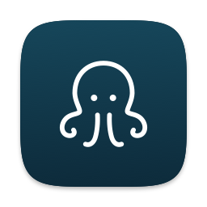

# Loco Loco

A macOS menu bar app for the localhost servers you have running. See them in one place, stop the ones you don't need, and restart them later from Stopped.

## Install

You need macOS 14 or later and the Xcode Command Line Tools. If `swift --version` prints nothing, run `xcode-select --install` first.

```sh
git clone https://github.com/Rakshitkeswani1210/loco-loco.git
cd loco-loco/app/macos
./scripts/build.sh
```

The script builds the app, puts it in `~/Applications` and opens it. An octopus shows up in the menu bar, with the number of running servers next to it. When nothing is running, the octopus sleeps.

macOS may ask to let Loco Loco access a folder such as Documents or Desktop. Click Allow, so it can name each server after its project folder.

To update, run `git pull` and the script again.

## Use

- Click the octopus to see Running and Stopped.
- Click a running row to open it in the browser. Hover it to stop it.
- Hover a stopped row to restart it. It runs the same command in the same folder, in the background.
- Right-click a row for Copy URL, Show in Finder, Open in Terminal, Show log, and Open in Cursor if you have Cursor.
- The ··· menu has Stop all, Launch at login and the other settings.

Loco Loco lists processes that listen on a port and run from a folder inside your home folder, so apps like Figma stay hidden. It can only see and stop your own processes.

## Your data

Everything stays on your Mac:

- History: `~/Library/Application Support/Loco Loco/history.json`. For each stopped server it keeps the folder, command, port and PATH, and no other environment variables.
- Restart output: `~/Library/Logs/Loco Loco/`

## Uninstall

Choose Quit Loco Loco from the ··· menu, then delete `~/Applications/Loco Loco.app` and the two folders above.

## Develop

- `app/macos/scripts/test.sh` runs the Mac tests.
- `docs/PLAN.md` has the decisions and how the app was checked. `PRODUCT.md` is the product brief.
- `docs/flow/` has the flow images, and `docs/brand/` the octopus.
- The HTML mockups in `mockups/` use SF Symbols, which aren't in the repo. To export them from your Mac, run this from the repo root:

  ```sh
  mkdir -p mockups/symbols
  swift mockups/tools/export-symbols.swift mockups/symbols $(cat mockups/tools/symbols.txt)
  ```

  The macOS wallpapers behind the mockups aren't included either, so you'll see plain blue instead.

## License

MIT. See [LICENSE](LICENSE).
